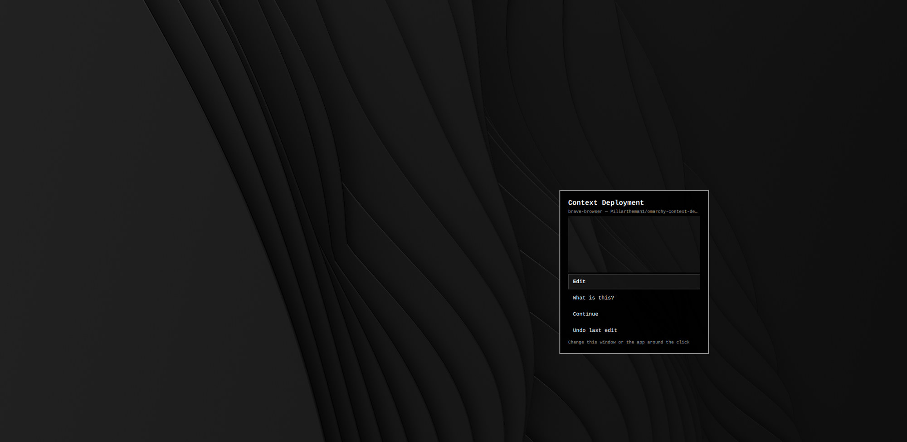

# Context Deployment



Super+right-click the Omarchy desktop to edit what is under the cursor with your default coding agent.

**ID:** `daniel.desktop-context`

Unofficial. Not affiliated with Omarchy.

Plugins run unsandboxed inside `omarchy-shell`. Only add this repo if you trust it.

## Install

```sh
omarchy plugin add https://github.com/Pillartheman1/omarchy-context-deployment.git --enable
```

`omarchy plugin add` does not install keybinds. Add this to `~/.config/hypr/bindings.lua` so Super+right-**click** opens the menu and Super+right-**drag** still resizes windows:

```lua
o.bind(
  "SUPER + mouse:273",
  "Context Deployment",
  os.getenv("HOME") .. "/.config/omarchy/plugins/daniel.desktop-context/scripts/open.sh",
  { click = true }
)
```

Then `hyprctl reload`. After plugin updates, run `omarchy restart shell` so the overlay is not left on stale QML.

## Usage

| Action | What it does |
|---|---|
| Edit | Prompt, then send click context + crop to `omarchy-agent` |
| What is this? | Same context; agent explains, does not edit |
| Dictate | Voxtype into the prompt (hidden if Voxtype is not installed) |
| Continue | Follow-up with a new click (after the first Inspect or Edit) |
| Undo last edit | Restore writes from this action's agent, and keep other sessions' edits |

Requires a default agent: `omarchy default agent <name>`.

## Remove

```sh
omarchy plugin remove daniel.desktop-context
```

Remove the Super+right-click bind from `bindings.lua` if you added it.
